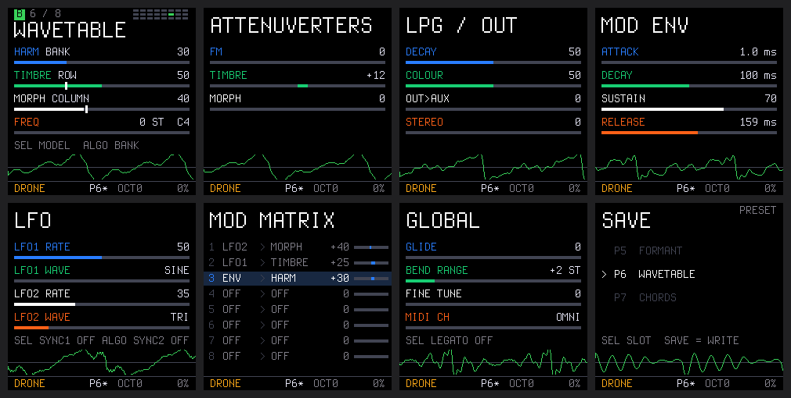

# GATOR manual

GATOR (as in alligator) turns the M-VAVE FM-1 into a monophonic macro-oscillator: 24 synthesis models, a low-pass
gate, an ADSR envelope and two LFOs, an 8-slot modulation matrix and 16 presets. It is inspired by Mutable
Instruments Plaits: the sound engine is the open-source DSP code of Emilie Gillet's Plaits (MIT), with its algorithms
unchanged, so it sounds like the module, with the CV inputs replaced by a modulation matrix and the knobs by the
FM-1's encoders. Not affiliated with or endorsed by Mutable Instruments.



- [Install](#install)
- [How the module maps to the FM-1](#how-the-module-maps-to-the-fm-1)
- [Buttons](#buttons)
- [GATE, TRIG and DRONE](#gate-trig-and-drone)
- [Pages](#pages)
- [Models](#models)
- [MIDI](#midi)
- [Screen](#screen)
- [Limits](#limits)

## Install

> Installing custom firmware is at your own risk. GATOR is provided as is, without any warranty.

Open the [web installer](https://npi3pak.github.io/fm1-gator/) in Chrome or Edge, connect the FM-1 by USB and press
**Install**. Or download a `.fwsc` from [Releases](https://github.com/npi3pak/fm1-gator/releases) and install it from
the command line:

```bash
pip install mido python-rtmidi
python3 tools/fm1_install.py gator-0.1.fwsc
```

Two packages are offered:

| Package | Sample rate | |
|---|---|---|
| `gator-X.Y.fwsc` | 44 117.6 Hz (192 MHz / 17 / 256) | the default, the codec clock of the platform |
| `gator-X.Y-48k.fwsc` | 48 076.9 Hz (160 MHz / 13 / 256) | the DSP's native rate, about 9% more CPU load |

The DSP computes its tuning from the real rate in both. Both packages carry the same update loader, so you can
switch between them, to another Felucca-platform firmware (SLOOP, ORBIT, ChoralRoot, AMB-1) or back to the official
firmware (the web installer's "Back to the official firmware") at any time.

### First start

1. Charge the FM-1, plug the cable straight into the computer, close other MIDI apps.
2. Install GATOR. After the restart the GATOR logo (with the version at the top right) and then the HOME page appear.
3. Press a key and watch the CPU percentage in the status line. Turn SELECT through all 24 models, especially
   2-OP FM, STRING and PARTICLE: `%!` or stuttering means a model runs out of CPU.
4. A red CRASH screen: note the PC / VEC shown and report it. After two failed boots in a row the FM-1 opens
   USB RESCUE by itself, where any firmware can be installed.

## How the module maps to the FM-1

| Module | FM-1 | Page |
|---|---|---|
| Model buttons, 3 banks × 8 | encoder **SELECT** (one by one), **ALGO** (a bank at a time), **HOME + key 1–24** | HOME |
| HARMONICS | **K1** (blue) | HOME |
| TIMBRE | **K2** (green) | HOME |
| MORPH | **K3** (white) | HOME |
| FREQUENCY | **K4** (orange): transpose ±24 semitones; notes come from the keys | HOME |
| FM / TIMBRE / MORPH attenuverters | K1 / K2 / K3 | SCL |
| Hidden LPG DECAY / LPG COLOUR | K1 / K2 | FX |
| V/OCT input | keys and MIDI notes, OCT− / OCT+ | — |
| TRIG input | a key press (TRIG mode) | — |
| MODEL, FM, HARMO, TIMBRE, MORPH, LEVEL inputs | the modulation matrix | EDIT |
| OUT and AUX outputs | OUT→AUX mix and stereo spread | FX |

## Buttons

| Button | Action |
|---|---|
| **HOME** | the main page; hold + key 1–24 to pick a model (the key's LED shows the current one) |
| **SCL** | attenuverters |
| **FX** | LPG and output |
| **ENV** | modulation envelope |
| **LFO** | LFO 1 and 2 |
| **EDIT** | modulation matrix |
| **GLO** | global settings |
| **SAVE** | the save page; press again to write the preset |
| **PLAY** | switch the play mode: TRIG → GATE → DRONE (LED on in GATE and DRONE) |
| **REC** | HOLD: notes keep sounding after release (LED on); switching it off releases all notes |
| **OCT− / OCT+** | keyboard octave −3…+3 |
| encoder **PRESET** | step through presets 1–16 on any page but SAVE (they load at once) |
| MASTER | volume |

System combinations: **OCT− + OCT+ for 5 seconds** enters UBOOT (JieLi's ROM loader); **OCT− held at power-on**
opens USB RESCUE for reinstalling.

## GATE, TRIG and DRONE

PLAY switches between three play modes; the mode is saved with the preset and shown at the left of the status line.

- **GATE** (the default for new patches and the melodic presets). A key press is a trigger, as in TRIG, but the
  volume follows the ADSR of the ENV page: the note sounds while the key is held, ends with RELEASE, and every knob
  is heard as you turn it. It is ENV → LEVEL without a matrix slot; a route of your own to LEVEL replaces it.
- **TRIG** ("a cable in TRIG", the module's own behaviour). A key press is a trigger: the internal LPG is pinged and
  the sound decays at the **DECAY** rate (FX) even while the key is held: a percussive, plucked mode. A knob turned
  after the hit is heard on the next note, since the note has died away. The drum, STRING and MODAL presets use it.
  Its internal decay envelope also modulates FREQ / TIMBRE / MORPH through the attenuverters of the SCL page.
  The exception is 6-OP FM I–III: they have their own DX7 envelopes, follow the gate and sound while the key is held.
- **DRONE** ("no cable"). The LPG is off, the sound is continuous and the keys only change the pitch. The
  attenuverters act as on the module without cables: FM is a fine tune within ±1 semitone. The drum models go into
  sustain, as on the module (a continuous tone without a hit), and STRING and MODAL are excited all the time.

GATE and a route to **LEVEL** both put an envelope into the module's LEVEL jack: the LPG stops pinging and opens
with it (preset P9 routes ENV → LEVEL 100 itself). The LEVEL depth is the gain itself: SUSTAIN 50 is half the amplitude (the module's LEVEL input is compressed so that everything above ~0.77
sounds equally loud; GATOR undoes that). While anything is routed to LEVEL, the FX page's DECAY does not slow the
fall: the envelope's DECAY and RELEASE set it. The LPG still softens the very shortest falls a little (a tail of
some tens of milliseconds).

## Pages

### HOME: model and main knobs

At the top: the bank (A/B/C), the model's number in the bank, a 3 × 8 grid with the current model, and its name.
The HARM / TIMBRE / MORPH rows are labelled with what the parameter does in the selected model (VIRTUAL ANLG:
DETUNE / SQUARE / SAW). The bar shows the knob's position, the white mark the value with the matrix's modulation.
The FREQ row shows the transposition and the current note. At the bottom: an oscilloscope of the output.

| Control | Parameter | Range |
|---|---|---|
| K1 / K2 / K3 | HARMONICS / TIMBRE / MORPH | 0–100 |
| K4 | FREQUENCY, transposition | ±24 semitones |
| SELECT | model | 1–24 |
| ALGO | model ±8 (the next bank) | |

The step follows the turning speed: slowly one step at a time, faster ×2, ×4, ×8. That holds for every continuous
parameter; models, LFO shapes, switches and K4 FREQUENCY always move one step.

### SCL: attenuverters

K1 **FM**, K2 **TIMBRE**, K3 **MORPH**, −100 to +100. As on the module: in TRIG mode they set how much of the
internal decay envelope goes to the pitch, TIMBRE and MORPH. When the matrix has a route to the same parameter
("a cable plugged in"), its attenuverter is not used: the route sets the depth. On SPEECH and CHIPTUNE these knobs
control the prosody / speed of speech and the envelope shape, as on the module.

### FX: LPG and output

| Knob | What |
|---|---|
| K1 DECAY | decay time of the LPG and the internal envelope |
| K2 COLOUR | the LPG's character: from VCA to filter |
| K3 OUT>AUX | mix of the main output and AUX (every model has its own AUX variant) |
| K4 STEREO | 0 mono; 100 OUT left, AUX right |

### ENV: modulation envelope

An ADSR started by every note. On its own it does nothing: it is the **ENV** source of the matrix.

| Knob | What | Range |
|---|---|---|
| K1 ATTACK | linear rise from the current level to 1 | 1 ms … 10 s |
| K2 DECAY | exponential fall to SUSTAIN | 1 ms … 10 s |
| K3 SUSTAIN | the level while the key is held | 0–100 |
| K4 RELEASE | exponential fall to zero after release | 1 ms … 10 s |

Times are shown in ms up to a second, then in seconds. The scale is logarithmic: a quarter turn of the range is ten
times the time (10 ms, 100 ms and 1 s at 25 / 50 / 75%). For DECAY and RELEASE it is the time to fall by 60 dB
(to 0.1% of the starting distance), as RT60 for reverbs; the envelope falls by 20 dB in a third of it. A release
during the attack goes straight to RELEASE from the current level; a new note (without LEGATO) starts its attack
from the current level, without a click.

### LFO

K1 / K3: rate of LFO1 / LFO2 (≈0.02–40 Hz). K2 / K4: shape: SINE, TRI, SAW, SQUARE, S&H (random steps), SMOOTH
(smooth random). SELECT / ALGO: SYNC, restarting LFO1 / LFO2 with every new note.

### EDIT: modulation matrix

Eight routes "source → destination × depth". SELECT (or ALGO) picks the route, K1 the source, K2 the destination,
K3 the depth in steps of 5, K4 the depth in steps of 1 (−100…+100). The bar on the right shows the route's current
contribution. Several routes to one destination add up.

Sources:

| | Value |
|---|---|
| LFO1, LFO2 | −1…+1 |
| ENV | 0…1 |
| VEL | note velocity, 0…1 (the FM-1's own keys have no velocity and send 100/127) |
| NOTE | pitch relative to C4, −1…+1 (keyboard tracking) |
| MODW | mod wheel (MIDI CC1), 0…1 |
| AFT | aftertouch (channel pressure), 0…1 |
| RAND | a new random value on every note, −1…+1 |
| GATE | 1 while a note is held |

Destinations (depth 100 at a source value of 1):

| | Effect | On the module |
|---|---|---|
| PITCH | ±12 semitones | FM input |
| HARM | ± the whole HARMONICS range | HARMO input |
| TIMBRE | ± the whole TIMBRE range | TIMBRE input |
| MORPH | ± the whole MORPH range | MORPH input |
| MODEL | ±8 models (latched on every trigger in TRIG mode) | MODEL input |
| LEVEL | gain / LPG opening; any route here stops the LPG pinging on a trigger | LEVEL input |
| LFO1 RT, LFO2 RT | LFO rate ±4 octaves | — |

A route counts as a plugged cable when it has a source, a destination and a non-zero depth. For PITCH / TIMBRE /
MORPH that switches the internal envelope off for that parameter, as on the module.

Examples:

- Vibrato: `LFO1 → PITCH +2`, LFO1 RATE ≈60.
- Filter envelope for VA VCF: `ENV → TIMBRE +45`.
- Pad: `ENV → LEVEL +100`, long ATTACK / RELEASE.
- A new word on every note in SPEECH: `RAND → MORPH +50`.
- The model follows the note: `NOTE → MODEL +50`.
- Slow timbre drift: `LFO2 → TIMBRE +30`, `LFO1 → LFO2 RT +40`.

### GLO: global

| Control | What |
|---|---|
| K1 GLIDE | portamento (saved with the preset) |
| K2 BEND RANGE | pitch bend range, 0–12 semitones |
| K3 FINE TUNE | ±100 cents |
| K4 MIDI CH | MIDI channel: OMNI or 1–16 |
| SELECT LEGATO | ON: a new note while another is held does not restart the trigger and the envelopes |

The voice is monophonic with last-note priority: release a note and the previous held one sounds again.

### SAVE: presets

16 slots in flash. SAVE opens the page, SELECT picks the slot, SAVE again writes it (SAVED appears at the bottom).
Any other page button cancels. An asterisk after the preset number in the status line (`P3*`) means unsaved
changes. The global settings are saved with the preset. The sound pauses while writing (a fraction of a second).

Factory presets (in GATE, except P3 and P12–P16 in TRIG and P10 in DRONE):

| | Model | What it shows |
|---|---|---|
| P1 | VIRTUAL ANLG | vibrato, LFO1 → PITCH |
| P2 | VA VCF | an envelope on the filter cutoff |
| P3 | 2-OP FM | the TIMBRE attenuverter: the internal envelope on the FM index |
| P4 | 6-OP FM I | DX7 patches, HARM picks the patch |
| P5 | FORMANT | a slow LFO on the formant |
| P6 | WAVETABLE | two LFOs scan the table |
| P7 | CHORDS | chords |
| P8 | SPEECH | RAND → MORPH: a new word on every note |
| P9 | STRING MACH | a pad, ENV → LEVEL, stereo OUT/AUX |
| P10 | WAVE TERRAIN | DRONE with two LFOs |
| P11 | CHIPTUNE | chiptune |
| P12 | STRING | plucked string |
| P13 | MODAL | modal resonator |
| P14 | BASS DRUM | kick (an octave down) |
| P15 | SNARE | snare |
| P16 | HI-HAT | hi-hat |

## Models

| Bank | # | Model | HARM | TIMBRE | MORPH |
|---|---|---|---|---|---|
| A | 1 | VA VCF | filter resonance / character | cutoff | waveform + sub |
| A | 2 | PHASE DIST | modulator frequency | amount | asymmetry |
| A | 3–5 | 6-OP FM I–III | DX7 patch (32 per bank) | brightness (modulator levels) | envelopes / "time" |
| A | 6 | WAVE TERRAIN | terrain | path radius | path offset |
| A | 7 | STRING MACH | chord | filter / chorus | registration |
| A | 8 | CHIPTUNE | chord | arpeggio / inversion | pulse width |
| B | 1 | VIRTUAL ANLG | detune | square → pulse → sync | triangle → saw |
| B | 2 | WAVESHAPER | waveshaper shape | fold amount | asymmetry |
| B | 3 | 2-OP FM | frequency ratio | modulation index | feedback |
| B | 4 | FORMANT | formant ratio | formant frequency | formant width |
| B | 5 | HARMONIC | number of spectral bumps | leading harmonic | bump shape |
| B | 6 | WAVETABLE | bank | row | column |
| B | 7 | CHORDS | chord type | inversion | waveform |
| B | 8 | SPEECH | synthesis → word banks | voice "species" | phoneme / word |
| C | 1 | SWARM | pitch spread | density | grain length |
| C | 2 | NOISE | LP → BP → HP | clock frequency | resonance |
| C | 3 | PARTICLE | frequency spread | density | filter type |
| C | 4 | STRING | material (inharmonicity) | excitation brightness | decay |
| C | 5 | MODAL | material | excitation brightness | decay |
| C | 6 | BASS DRUM | attack / overdrive | tone | decay |
| C | 7 | SNARE | tone ↔ noise | drum modes | decay |
| C | 8 | HI-HAT | metal ↔ noise | high-pass | decay |

Bank A holds the models added in the module's firmware 1.2, banks B and C the original 16. The module's
[manual](https://pichenettes.github.io/mutable-instruments-documentation/modules/plaits/manual/) describes the
sound of every model and its AUX output in detail.

## MIDI

USB-MIDI and TRS MIDI IN (3.5 mm); the channel is set on the GLO page.

| Message | Action |
|---|---|
| Note On / Off | notes (velocity → the VEL source) |
| CC 1 | mod wheel → the MODW source |
| CC 16 / 17 / 18 | HARMONICS / TIMBRE / MORPH |
| CC 19 | model (0–127 → 1–24) |
| CC 120, 123 | all notes off |
| Channel pressure | the AFT source |
| Pitch bend | pitch, range BEND RANGE |

## Screen

The status line: the play mode (`GATE` / `TRIG` / `DRONE`), `HOLD`, the preset number (`*`: changed), the octave, and the audio interrupt's
load in percent. Above 75% the number turns red; `%!` means the overload guard skipped audio (below).

## Limits

- **CPU.** The DSP was written for a 72 MHz Cortex-M4 with an FPU. The FM-1's core (JieLi AC79, pi32v2) is faster
  and has a single-precision FPU, which GATOR uses (`-mcpu=r3 -mfprev1`, as the official SDK builds). When the audio
  interrupt keeps taking more than ~85% of the time, the guard plays a block of silence so that the interface, USB
  and the watchdog keep running: the sound stutters and `%!` appears in the status line. The heaviest models are
  2-OP FM, STRING and PARTICLE.
- **No user data.** The custom wavetables and DX7 banks the module receives as audio cannot be loaded; 6-OP FM uses
  the built-in banks.
- **Monophonic**, as the module. The FM-1's keys have no velocity.
- **Storage.** GATOR writes only `0xF7000..0xFAFFF` of the flash (its preset slots). On ORBIT that is the USR4
  sample slot: after going back to ORBIT it is empty; ORBIT's projects and settings are not touched. If the FM-1
  holds data of another firmware, back it up with that firmware's tools before installing.
